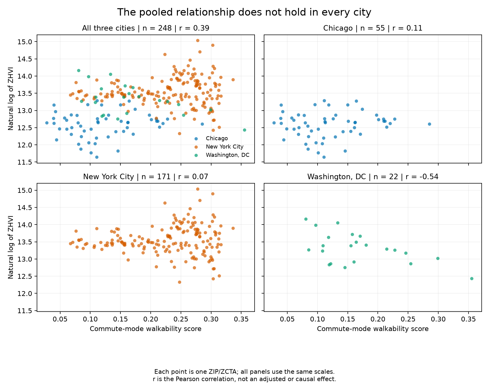
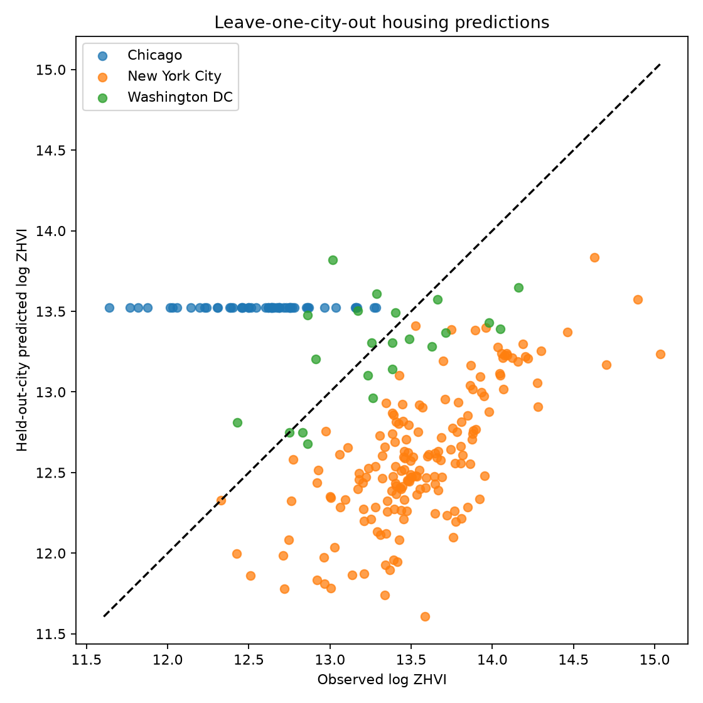

# Housing Values and Commuting Patterns Across Three Cities

A relationship can look strong when cities are combined but look different
inside each city. This project compares Zillow housing values with Census
commuting, income and other estimates for Chicago, New York City and Washington,
DC. Each row represents one ZIP/ZCTA: a postal ZIP code matched to its approximate
Census counterpart, a ZIP Code Tabulation Area.

The project asks three questions:

1. **Does combining cities hide differences within them?** Compare the
   [combined and city-specific relationships](#the-relationship-changes-when-cities-are-separated).
2. **Does the relationship change after accounting for other factors?** Examine
   the [models that include income, city and other controls](#methods-and-limitations).
3. **Can a model predict a city left out of training?** Check
   [predictions made using the other two cities](#models-trained-in-two-cities-predict-the-third-poorly).

**Main finding:** the positive relationship in the combined data is weak or
negative within individual cities. Including other factors also changes the
estimated relationship, and this model and its inputs predict a city left out
of training poorly overall. None of this establishes that commuting choices or
walkability cause housing values to rise or fall.

This project builds on an earlier exploratory analysis. The data definitions
and research question were refined after early results were reviewed, rather
than fixed before the analysis began.

## Results

| Comparison | Result |
|---|---|
| Correlation across all cities: commute proxy vs. log housing value | 0.39 |
| Within-city correlations | Chicago 0.11; New York City 0.07; Washington, DC −0.54 |
| OLS model with city and other controls: proxy coefficient | −1.9095; HC3 p≈0.001; R²≈0.783 |
| Lasso predictions for cities left out of training | Overall R²≈−1.879: worse than the overall-mean benchmark |

**How to read these results:**

- **Correlation** describes how two measures move together, from −1 to +1.
  “Pooled” means all three cities are combined.
- **OLS (ordinary least squares)** estimates the relationship while accounting
  for the included controls and differences between cities. The coefficient
  implies about **1.89% lower estimated housing value for a 0.01 higher proxy
  score**, holding those factors constant. This is not a causal effect.
- **HC3** is the method used to calculate standard errors when the spread of
  model errors may vary. The **p-value** measures how incompatible the result
  is with a zero coefficient under the model's assumptions; it does not measure
  the size or practical importance of the relationship.
- **R²** compares squared errors with the errors from using the mean of log
  housing value. The OLS value describes fit to the observed sample. The Lasso
  value measures predictions for cities left out of training; its negative value
  means those predictions
  were worse than the overall-mean benchmark. These are different model setups
  and evaluation tasks, not a like-for-like model ranking.

The relationship differs by city and changes with the factors included in the
model. A positive correlation in the combined data is not enough to conclude
that higher walkability is associated with higher housing values everywhere.

### The relationship changes when cities are separated

The pooled correlation is **0.39**, but it is weak in Chicago (**0.11**) and
New York City (**0.07**) and negative in Washington, DC (**−0.54**). All four
panels use the same axes. Each point is one ZIP/ZCTA; the correlations describe
these observations without adjusting for income or other controls.

### Models trained in two cities predict the third poorly

Each prediction comes from a model trained on the other two cities. The dashed
line marks a perfect prediction; points far from it show large errors. Overall
leave-one-city-out **R² is −1.879**, worse than the overall-mean benchmark.
Errors are measured in log housing-value units, not dollars. The final model
fitted to all three cities is not used for these transfer predictions.

Both charts use the same **248-observation** sample: March 2025 Zillow ZHVI and
2022 ACS five-year estimates. They show associations, not causal effects.
**Data Provided by Zillow Group** ([Zillow Research](https://www.zillow.com/research/data/)).
Commuting and other estimates: [U.S. Census Bureau ACS](https://www.census.gov/programs-surveys/acs).
This is an independent analysis, with no Zillow affiliation or endorsement.
[Figure sources and regeneration instructions](docs/figures/README.md) explain
how these public images were produced. Maps and other diagnostics remain
available from the analysis command rather than crowding the project page.

## Data and Study Areas

- **ZHVI:** Zillow Home Value Index, an estimate of typical home value. The
  outcome is its natural logarithm, using the **2025-03-31** observation.
- **ACS:** **2022 five-year** Census estimates of commuting, income, home ownership,
  education and population. The periods do not align exactly with Zillow.
- **Commute-mode proxy:** `0.5 × walk share + 0.4 × transit share + 0.1 × bicycle share`.
  This is not official Walk Score or a direct measure of sidewalks, destinations
  or street connectivity. Its weights are study choices. Existing code calls it
  `Walkability_Score` or `walkability_score`; those names do not make it a direct
  measure of walkability or an analysis of every travel mode.

PostgreSQL keeps all 250 source rows. Two ZCTAs, `10037` and `60602`, lack the
separate ACS median home-value estimate required by the shared analysis rules.
They are excluded from analysis, not deleted from the source tables. The
remaining 248 rows include Chicago 55, New York City 171, and Washington, DC 22.
Each ZIP/ZCTA counts once; results are not weighted by population or number
of homes.

### A secondary comparison: higher proxy scores and lower housing values

An existing flag selects rows with housing values strictly below the full
analysis sample's median and proxy scores strictly above its median. It selects
**51 of 248 observations**. Its code name is `Is_Walkable_and_Affordable` or
`is_walkable_and_affordable`, but it does **not** measure household affordability,
use household budgets or recommend places to live. City selection must not
recalculate this fixed comparison using different medians.

### Why these cities?

The three cities were selected in the original project, not randomly sampled.
Their established transit systems and differing housing and commuting patterns
make the comparison useful, but the cities were not chosen through a systematic
matching process and do not represent all U.S. cities.

The filters select ZIPs associated with the three cities, **not their wider
metropolitan areas**:

- New York City: New York State ZIPs in its five borough counties.
- Washington, DC: state `DC`, Zillow city `Washington`.
- Chicago: state `IL`, Zillow city `Chicago`, Cook County.

Postal ZIPs and Census ZIP Code Tabulation Areas (ZCTAs) are approximate
counterparts, not identical boundaries. These assignments do not precisely
follow municipal boundaries or include the surrounding suburbs.

## How the Project Runs

**Zillow CSV + Census ACS → Python preparation → PostgreSQL source tables → SQL
features and rankings → Python models → saved tables and figures**

The command-line workflow needs no notebook. GeoPandas reads optional map
shapes from local files; PostgreSQL stores no polygons and needs no PostGIS.
Python and SQL prepare and analyze the data. A Tableau Public dashboard is
planned for interactive city comparisons; it is not yet built or published.

## Setup

### 1. Install Python dependencies

Python 3.13 is the tested runtime; the package requires Python 3.13 or newer.
From the repository root, create and activate a virtual environment:

- macOS/Linux: `python3 -m venv .venv`, then `source .venv/bin/activate`.
- Windows PowerShell: `py -3.13 -m venv .venv`, then `.\.venv\Scripts\Activate.ps1`.

Install with `python -m pip install -e .`. Required package versions are listed in
`requirements.txt`. Keep this checkout in place: the package reads its SQL and
local data paths from the repository.

### 2. Download the source files

**Zillow:** open [Zillow Research Data](https://www.zillow.com/research/data/),
select Home Values → ZHVI All Homes (SFR, Condo/Co-op), Smoothed, Seasonally
Adjusted → ZIP Code. Save the CSV as:

`data/housing/Zip_zhvi_uc_sfrcondo_tier_0.33_0.67_sm_sa_month.csv`

The file must contain `2025-03-31`. Zillow may revise historical values, so a
fresh download can differ from the input used for the reported results.

**Census ACS:** the loader downloads two 2022 ACS tables. Request a free
[Census API key](https://api.census.gov/data/key_signup.html), copy `.env.example`
to `.env`, and fill in `CENSUS_API_KEY`. A successful API-based load saves a
local CSV copy to `data/acs/acs_zip_2022.csv` for inspection.

**Optional maps:** from the [Census shapefile downloader](https://www.census.gov/cgi-bin/geo/shapefiles/index.php),
choose 2024 → ZIP Code Tabulation Areas. Extract the national
`tl_2024_us_zcta520.zip` into `data/geo/`. Keep the `.shp`, `.dbf`, `.shx`, `.prj`
and `.cpg` files together. The expected main file is
`data/geo/tl_2024_us_zcta520.shp`, with the `ZCTA5CE20` key field.
The extra files are shapefile sidecars: they hold attributes, indexes and map
projection information needed alongside the `.shp` file.

Source files, `.env`, generated results and the virtual environment are ignored
by Git. Never commit passwords or API keys.

### 3. Start PostgreSQL

Install and start [Docker Desktop](https://www.docker.com/products/docker-desktop/).
Fill in the PostgreSQL settings in `.env`, preserving the Census key, then run
`docker compose up -d --wait`.

The PostgreSQL 17 service binds only to `127.0.0.1` and keeps data in a named
volume. Default user/database names are `walkability`. `POSTGRES_PASSWORD` is a
separate local database password—not your operating-system or Census password.

Exported environment variables override `.env`. Keep `.env` private; on macOS,
restrict it to owner read/write access. Do not print resolved Compose settings.
Stopping with `docker compose stop` preserves the volume. Editing `.env` alone
does **not** rotate an existing database password: update the database role and
local setting together. Do not delete the volume merely to change a password.

An existing PostgreSQL 17 server can use the same connection settings. Use a
dedicated study database and a role able to create tables/views and
read/insert/update rows in `public`. This local setup uses the administrator
account created by the PostgreSQL image; it is not a production deployment design.

## Load Data

Run `python -m walkability.pipeline`. To reuse a trusted cached extract without
contacting Census, run
`python -m walkability.pipeline --acs-file data/acs/acs_zip_2022.csv`.
The saved CSV has no year column, so you must confirm it contains the trusted
2022 extract. If an API request fails, the loader stops rather than silently
substituting a saved file.

Add `--validate-only` to check inputs without connecting to PostgreSQL or writing
files. Without an explicit cached extract, validation still calls Census.

| Source table | Primary key | Contents |
|---|---|---|
| `dim_geography` | `zcta` | Study area and Zillow city/county/state |
| `fact_housing` | `(zcta, observation_date)` | Positive finite ZHVI |
| `fact_acs` | `(zcta, acs_year)` | Commuting, income, housing, education and population estimates |

Keys remain five-digit text. Constraints enforce valid values and foreign keys.
Unavailable estimates remain NULL (missing), never zero. Source percentages stay
in 0–100 units; SQL converts them to 0–1 shares. Double-precision numbers preserve
the source values without rounding them to cents.
Boolean values such as `True` and `False` are rejected in numeric source fields,
not converted into estimates of 1 and 0.

Table setup, row inserts/updates, coverage checks and view setup are saved in one
database transaction. If a step fails, none of that load is saved. Repeated loads
update matching keys without duplicates. Unexpected current-study keys cause
failure rather than deletion. Historical
fact periods are preserved. `CREATE TABLE IF NOT EXISTS` lets setup run again;
it does not update the layout of tables that already exist.

### SQL features and rankings

- `vw_analysis_features`: joins the chosen source periods, keeps rows with all
  required estimates, and calculates natural logs, ratios, shares, the proxy
  score and the fixed higher-proxy/lower-value flag.
- `vw_city_rankings`: within-city ranks, percent-ranks, means and deviations,
  plus repeatable top/bottom selection orders. Equal values share ranks;
  selection orders break ties by ZCTA. These ranks cover each city's eligible
  study rows, not every city ZIP. Housing rank 1 means **most expensive**.

For loaded tables, install just the views with
`python -m walkability.pipeline --views-only`. This makes no source requests or
changes to source rows. It cannot be combined with source-file options or
validation mode.
`sql/analysis.sql` supplies four standalone SELECT examples. Its city-mean
comparison is an extra descriptive example, not a replacement for the fixed flag.

## Run the Analysis

Run `python -m walkability.analysis --output-dir outputs/my-run`.
Add `--maps` for all three city maps; `--geometry-file` can select another copy
of the same source geometry. Without `--maps`, geometry is not read.
The installed aliases are `walkability-load` and `walkability-analyze`.

Model fitting requires usable observations from all three study areas. If a
city is missing after filtering, analysis stops before fitting rather than
silently running a different study. Check source coverage and unavailable
estimates; do not remove the check just to obtain results. The SQL reader still
supports smaller samples for inspection and tests.

If maps cannot be read, the error points to `--geometry-file` and the required
shapefile sidecars. Geometry problems are reported separately from output-saving
failures. Raw file-reader and database exception details are not printed.

The reader fetches analysis columns, rankings and a source-coverage check table
in one read-only database snapshot. All three reads see the same data even if
another connection changes the tables. It checks keys, periods, usable numbers
and matching rows, then closes the connection before modeling. Analysis makes
no Census requests and does not read either notebook or source CSVs.

Exports include OLS coefficients and fit statistics, cluster assignments and
stability scores, predictions and errors for cities left out of training, Lasso
coefficients, SQL rankings, source-coverage checks and summary metrics. Six images
are saved:
pooled/within-city relationships, correlations, clustering diagnostics, cluster
profiles, Lasso coefficients and geographic transfer. Optional maps bring the
total to **nine PNGs**. All maps use the same color range and require one
geometry per observation.

**Output safety:** the destination must not exist, even as an empty folder or
symlink. Files are first written to a temporary folder beside the destination.
That folder moves to the final path only after every export succeeds. Ordinary
failures clean up their temporary
files. A forced kill or power loss can leave a hidden `.<name>-incomplete-*`
folder; parent directories may remain empty. Previous results are never deleted.
Concurrent runs into the same destination are not supported.

## Tests and Verification

### Python formatting and lint checks

For development, install `python -m pip install -e ".[dev]"`. This adds the
project's chosen version of Ruff; running the analysis does not need it.

- Check common mistakes, unused imports and import order:
  `python -m ruff check src tests`.
- Check formatting: `python -m ruff format --check src tests`.
- Apply import fixes: `python -m ruff check --select I --fix src tests`, then
  format with `python -m ruff format src tests`.

CI runs both checks without changing files. The rules stay small: basic Python
errors and import order, plus consistent formatting. Notebooks, SQL, data and
local planning notes are outside these checks. Formatting does not replace tests
or a review of the results.

### Automated tests

Keep `tests/` in Git alongside the code it checks. Anyone cloning the project
can run the same checks, and GitHub Actions uses these files on every push and
pull request. The tests use invented data, not private source files or real
credentials. Temporary files are cleaned up by the tests; caches, generated
outputs and local secrets are excluded by `.gitignore`.

Run `python -m unittest discover -s tests -v` for the offline tests. They check
source parsing and preparation, the three-city requirement, model setup, safe
errors, output cleanup, figure rendering and map coverage. Invented records and
simulated Census responses cover ZIP formatting, city filters, missing-value codes,
bicycle-share calculations and malformed API responses. No database, API key,
external data request or downloaded study data is needed for these tests.

Eight PostgreSQL tests are skipped unless `TEST_DATABASE_DSN` is explicitly set.
Point it at a **separate test server that can be discarded**, never a production
or study server. The role must be allowed to create and drop databases. Each
test creates a random
`walkability_test_*` database and registers cleanup to drop only that database.
Tests never read `.env` or fall back to the study connection. They cover formulas,
ties, strict median rules, missing data, historical periods, repeat loads and rollback.

[GitHub Actions](https://github.com/mqhaji/walkability-project/actions) runs the
suite on pushes and pull requests with Python 3.13 and temporary PostgreSQL 17.
Its password is a temporary test value. The runner needs internet to install
dependencies, but tests make no external data requests.
The [run for `256ec33` passed](https://github.com/mqhaji/walkability-project/actions/runs/41353587831).
Check the Actions page for later commits rather than assuming this result covers
new changes.

The full local suite passed **44 tests** (36 offline and eight PostgreSQL tests).
Separately, all 35 SQL analysis columns matched independently calculated
reference values within `1e-12`. Script regression estimates,
HC3 errors, all 248 transfer predictions, bootstrap scores and Lasso coefficients
matched notebook calculations within `1e-10`. Cluster groupings agreed exactly
and all 248 observations mapped. Tests with invented data check code behavior;
they do not independently reproduce the research from real data.

### Commit messages

Use [Conventional Commits](https://www.conventionalcommits.org/en/v1.0.0/) for
new commits: `<type>: <short description>`. Add an optional scope when useful,
as in `fix(loader): reject duplicate ZIPs`.

- `feat`: add a capability, such as the Tableau CSV export.
- `fix`: correct a bug.
- `docs`: change documentation or explanatory text without changing behavior.
- `test`: add or change tests.
- `refactor`: reorganize code without changing behavior.
- `ci`: change the automated checks.
- `chore`: other maintenance, such as removing unused dependencies.

Keep descriptions in plain English, describing what changed rather than just
the files touched. For example: `docs: explain how to download the source data`.
Use this style from now on; do not rewrite existing commits just to rename them.
No commit-message hooks or extra packages are required.

## Methods and Limitations

The primary OLS model uses the proxy, log median income, commute time, renter share,
college-graduate share, log population and city indicators. HC3 standard errors
address unequal residual variance, not spatial dependence or omitted variables.
Large condition numbers warn that differing scales or overlapping predictors
may make estimates sensitive. The separate model that adds the ACS
home-value-to-income ratio is a sensitivity check, not the primary model,
because that ratio contains another measure of housing value.

KMeans groups rows by four measures after putting them on comparable scales.
The analysis compares two through six clusters, uses three, and checks stability
with 100 resamples drawn with replacement. These groups are descriptions, not
established neighborhood types.

Lasso is a linear model that shrinks coefficients to reduce overfitting. Each
test holds out one city. The other two cities are used to select the penalty
through an inner round of city-based validation. Scaling is fitted within the
training folds, so held-out data does not influence it. A final fit uses all
three cities to describe coefficients, not to produce a new performance estimate.

The main limits are the commute-based proxy, three selected cities, approximate
boundaries, spatial dependence, mismatched periods and omitted variables. More
cities, better built-environment measures and longitudinal data are research next
steps. The poor predictions are part of the findings, not a result omitted from
the report.

## Repository Guide

| Path | Purpose |
|---|---|
| `src/walkability/config.py` | Paths, fixed periods and connection settings |
| `src/walkability/extract.py`, `prepare.py`, `pipeline.py` | Source extraction, validation and loading command |
| `src/walkability/database.py` | Save each load together and read analysis data without changing it |
| `src/walkability/analysis.py`, `figures.py` | Model command and figure exports |
| `sql/schema.sql`, `views.sql`, `analysis.sql` | Source tables, analytical views and example queries |
| `tests/` | Offline tests and PostgreSQL tests enabled by an explicit test connection |
| `.github/workflows/tests.yml` | Automated test workflow |
| `compose.yaml` | Local PostgreSQL service |
| `data/README.md` | Local input directory guide |
| `docs/figures/` | Selected public results and regeneration notes |
| `outputs/` | Generated results, ignored by Git |

### Reference notebooks

Neither notebook is required by the main workflow. Both are preserved for comparison.

- `notebooks/walkability_analysis_postgres.ipynb` reads SQL views and local
  geometry. Select the `.venv` kernel and restart/run all cells to inspect it.
- `notebooks/walkability_analysis.ipynb` is the original reference. Running it
  contacts Census and rewrites the cached ACS extract; it is not needed to
  execute the current analysis.

A Tableau Public dashboard is planned for interactive city comparisons. It will
display an exported historical snapshot, not a live connection to this database.
It is not yet implemented; no additional models are planned. Both notebooks
will be removed in a separate commit after the script and Tableau workflow is
verified. Their history will remain available in Git.